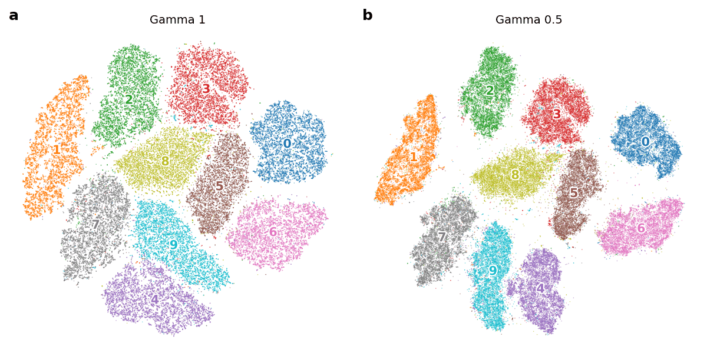

.. _choosing-an-affinity-class:

Choosing an affinity class
==========================

One key component of t-SNE is its affinity matrix :math:`P`. It shows neighbors for each point and how strongly each of these neighbors matters. By default, openTSNE computes the standard t-SNE affinities with :class:`.PerplexityBasedNN`. Other affinity classes can be passed to :meth:`openTSNE.TSNE.fit`.

Smoothing the affinities with gamma
-----------------------------------

In standard t-SNE, the Gaussian bandwidth of every point is chosen so that each row of the affinity matrix ends up having the same perplexity. However, these rows are generally sharp: the first few nearest neighbors often hold most of the probability mass in a row, and they dominate the attractive forces during optimization. :class:`.GammaSmoothedPerplexityNN` changes how probability is spread among the neighbors of each point, without changing which neighbors are used. Each row of the conditional probabilities :math:`p_{j|i}` is raised to the power :math:`\gamma` and renormalized, before the matrix is symmetrized:

.. math::

    \tilde{p}_{j|i} = \frac{p_{j|i}^{\gamma}}{\sum_{m \neq i} p_{m|i}^{\gamma}}

With :math:`\gamma = 1`, this gives the standard t-SNE affinities. Values between 0 and 1 smooth each row, moving probability mass from the nearest neighbors to farther ones, and values above 1 make each row even sharper. For any :math:`\gamma > 0`, the neighbors and their order stay the same, and the number of neighbors stays the same, so the runtime is mostly the same.

Raising the probabilities to the power :math:`\gamma` is the same as dividing the Gaussian bandwidth of each point by :math:`\sqrt{\gamma}`. This is not the same as using a larger perplexity. With a larger perplexity, all points get the same new perplexity. With smoothing, each point gets its own effective perplexity. The value of this point-dependent perplexity depends on how sharp the row was [1]_. The same :math:`\gamma` is used when embedding new points.

To use it, pass the affinities to :meth:`openTSNE.TSNE.fit`:

.. code-block:: python

    from openTSNE import TSNE
    from openTSNE.affinity import GammaSmoothedPerplexityNN

    affinities = GammaSmoothedPerplexityNN(x, perplexity=30, gamma=0.5)
    embedding = TSNE().fit(x, affinities=affinities)

    **Figure 1**: Smoothing the affinities can separate clusters more clearly. We embed MNIST (70,000 digits, reduced to 50 principal components) with perplexity 30 and the same initialization, using a) the standard affinities (gamma 1) and b) smoothed affinities (gamma 0.5). With smoothing, the clusters are more compact and are more clearly separated, for example digits 4 and 9.

When to use a different gamma
~~~~~~~~~~~~~~~~~~~~~~~~~~~~~

The default of :math:`\gamma = 1` is a good starting point. Smoothing (:math:`\gamma < 1`) preserves broader local neighborhoods and global structure better, while sharpening (:math:`\gamma > 1`) preserves the very nearest neighbors better [1]_. If you care about larger neighborhoods or cluster structure, as in Figure 1, try a value between 0.5 and 0.9.

The effect on local neighborhoods is strongest at low perplexity, where the rows are sharpest. At higher perplexities, the best :math:`\gamma` moves toward 1 or slightly above. Perplexity and :math:`\gamma` do different things: the perplexity sets how many neighbors are included, and :math:`\gamma` sets how the probability is shared among them. The best value depends on the data set, the perplexity, and the neighborhood size you care about.

References
----------
.. [1] Mohebi, Shirin, Bied, Guillaume, and Lijffijt, Jefrey. `“How smoothing the affinity matrix affects neighborhood preservation in t-SNE” <https://arxiv.org/abs/2608.17190>`__, arXiv (2026).
