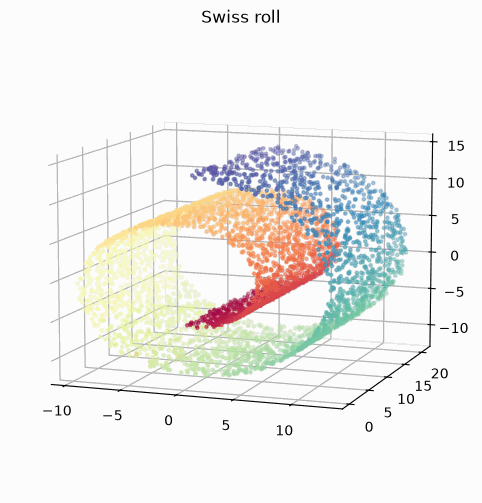
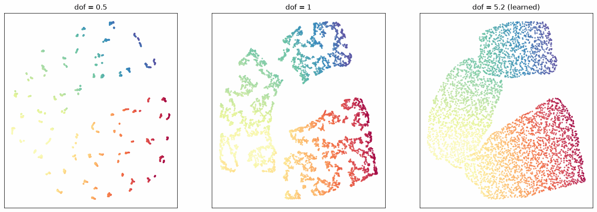
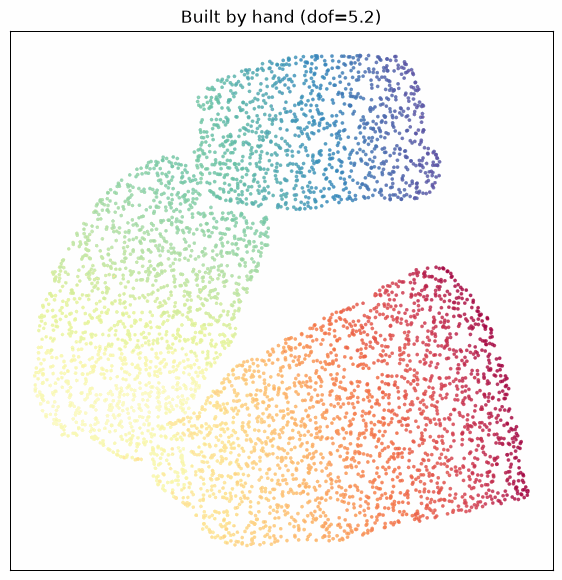
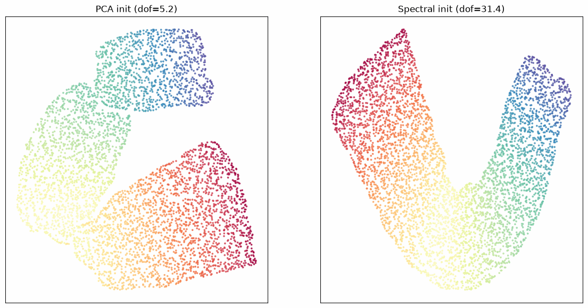

.. _degrees-of-freedom:

Degrees of freedom
==================

The degrees of freedom :math:`\alpha` (sometimes called ``dof`` or :math:`\nu`)
control the heaviness of the tails of the t-SNE kernel. openTSNE uses the
heavy-tailed kernel of Kobak et al. [1]_

.. math::

    k(\mathbf{y}_i, \mathbf{y}_j) =
    \left( 1 + \frac{\lVert \mathbf{y}_i - \mathbf{y}_j \rVert^2}{\alpha} \right)^{-\alpha} .

With :math:`\alpha = 1` the expression simplifies to the standard Student-t
kernel used in ordinary t-SNE,

.. math::

    k(\mathbf{y}_i, \mathbf{y}_j) =
    \left( 1 + \lVert \mathbf{y}_i - \mathbf{y}_j \rVert^2 \right)^{-1} ,

which is the default. openTSNE evaluates this simpler form directly whenever
:math:`\alpha = 1` and only falls back to the general kernel for other values.
Lowering :math:`\alpha` makes the tails heavier, which tends to pull apart
clusters and reveal finer structure, while larger values produce a more
Gaussian-like kernel. Choosing a good value by hand can be tedious, so openTSNE
can also *learn* the degrees of freedom during optimization.

The ``dof`` parameter and the ``dof_`` attribute
------------------------------------------------

Two related names appear throughout the API, and it helps to keep them apart:

``dof``
    A parameter that tells openTSNE *how* to treat the degrees of freedom on a
    given call. It may be a number, in which case the degrees of freedom are
    held **fixed** at that value, or the string ``"auto"``, in which case they
    are **learned** during optimization.

``dof_``
    An attribute on every embedding holding the degrees of freedom that were
    actually used. After optimization this is the value the kernel was
    evaluated with: the fixed value for a fixed ``dof``, or the learned value
    for ``dof="auto"``. You can always read ``embedding.dof_`` without having to
    know which mode was used.

    The trailing underscore follows the scikit-learn convention for attributes
    that are set as a result of fitting, like :attr:`~openTSNE.TSNEEmbedding.kl_divergence_`:
    it marks ``dof_`` as something the library computes for you, not something
    you configure.

In short, ``dof`` is the *instruction* and ``dof_`` is the *result*.

.. warning::

    Unlike most fitted attributes, ``dof_`` is not purely informational.
    openTSNE reads it back to decide where to continue from: a subsequent
    ``dof="auto"`` optimization warm-starts from ``embedding.dof_``.
    Overwriting ``embedding.dof_`` by hand therefore changes later
    optimization — it is not a cosmetic relabelling. To run with a different
    value, pass ``dof`` to :meth:`~openTSNE.TSNEEmbedding.optimize` or
    :class:`~openTSNE.TSNE` rather than assigning to ``dof_``.

Standard t-SNE
--------------

By default the degrees of freedom are fixed at ``1``, giving ordinary t-SNE:

.. code-block:: python

    from openTSNE import TSNE

    embedding = TSNE().fit(x)        # dof=1, standard t-SNE
    embedding.dof_                   # 1.0

A fixed, lower value yields a heavier-tailed kernel:

.. code-block:: python

    embedding = TSNE(dof=0.5).fit(x)
    embedding.dof_                   # 0.5

To let t-SNE find a suitable value on its own, set ``dof="auto"``. The learned
value is written to ``dof_`` once optimization finishes:

.. code-block:: python

    embedding = TSNE(dof="auto").fit(x)
    embedding.dof_                   # e.g. 0.73, the learned value

Learning the degrees of freedom is supported with both the Barnes-Hut
(``negative_gradient_method="bh"``) and the interpolation-based FFT
(``negative_gradient_method="fft"``) gradients.

Learning and exaggeration
~~~~~~~~~~~~~~~~~~~~~~~~~

t-SNE runs in two phases: an *early exaggeration* phase, which multiplies the
attractive forces to let clusters form, followed by the normal optimization
phase. Exaggeration scales the attractive term of the dof gradient in the same
way, but not its repulsive term. Under exaggeration, the dof gradient is
therefore not the gradient of the KL divergence, and learning settles on a
value that does not minimize it. In practice this can change which clusters
split apart. For this reason, :class:`~openTSNE.TSNE` holds the degrees of
freedom at ``1`` during early exaggeration and learns them only in the normal
phase.

Learning starts from ``1`` by default. A different starting point can be
supplied with ``initial_dof``, which takes effect at the start of the normal
phase:

.. code-block:: python

    embedding = TSNE(dof="auto", initial_dof=2).fit(x)
    # early exaggeration: dof held at 1
    # normal phase:       learning starts from 2

``initial_dof`` only applies when ``dof="auto"``; it is ignored (with a warning)
for a fixed ``dof``.

Learning still runs under exaggeration if you ask for it, for instance with
``TSNE(dof="auto", exaggeration=4)``, or by optimizing a ``dof="auto"``
embedding with ``exaggeration=12``, but openTSNE emits a warning.

Optimizing in phases
~~~~~~~~~~~~~~~~~~~~~~

Embeddings can be optimized incrementally with
:meth:`~openTSNE.TSNEEmbedding.optimize`, and the degrees of freedom carry over
between calls. The ``dof`` mode chosen when the embedding was created is
remembered, so there is no need to repeat it: a further ``optimize`` call simply
continues learning from where the previous one left off, with ``dof_`` recording
the current value.

.. code-block:: python

    embedding = TSNE(dof="auto").fit(x)   # embedding.dof_ holds the learned value
    embedding = embedding.optimize(250)   # continues learning from embedding.dof_

The same applies when constructing an embedding by hand rather than through the
:class:`~openTSNE.TSNE` estimator. The starting value lives on the embedding:
a freshly built ``dof="auto"`` embedding has ``dof_`` set to ``1`` (or to
``initial_dof``), and each call resumes from the current ``dof_``. To follow
the same schedule as :class:`~openTSNE.TSNE`, hold the degrees of freedom fixed
during early exaggeration:

.. code-block:: python

    from openTSNE import TSNEEmbedding, affinity, initialization

    affinities = affinity.PerplexityBasedNN(x, perplexity=30)
    init = initialization.pca(x)

    embedding = TSNEEmbedding(init, affinities, dof="auto", negative_gradient_method="bh")
    embedding = embedding.optimize(250, exaggeration=12, dof=1)   # dof held at 1
    embedding = embedding.optimize(500)                           # learns, starting from 1

Passing a number to :meth:`~openTSNE.TSNEEmbedding.optimize` fixes the degrees of
freedom at that value for that call only. The mode the embedding was created
with is unchanged, so a later call without ``dof`` goes back to learning. This
is also how to run with the learned value frozen:

.. code-block:: python

    embedding = TSNE(dof="auto").fit(x)                       # learns, e.g. dof_ == 0.73
    embedding = embedding.optimize(250, dof=embedding.dof_)   # frozen at 0.73
    embedding = embedding.optimize(250)                       # learning resumes from 0.73

To restart learning from a particular value, pass ``initial_dof`` to
:meth:`~openTSNE.TSNEEmbedding.optimize`. It sets ``dof_`` to that value before
the call learns from it, and like ``dof``, it applies to that call only:

.. code-block:: python

    embedding = embedding.optimize(250, initial_dof=2)        # learning restarts from 2

A worked example: the Swiss roll
--------------------------------

The effect of the degrees of freedom is easiest to see on the *Swiss roll*: a
two-dimensional sheet rolled up in three dimensions. Because it is a single
continuous manifold rather than a set of clusters, it makes a good test of how
the tail heaviness reshapes an embedding. We colour each point by its position
``t`` along the roll, so that a faithful embedding unrolls the sheet while
keeping the colour gradient continuous.

.. code-block:: python

    from sklearn.datasets import make_swiss_roll

    x, t = make_swiss_roll(n_samples=5000, noise=0.05, random_state=42)

A heavier-tailed kernel (small ``dof``) pulls neighbouring points apart. On
clustered data this helps to separate clusters, but on a continuous manifold it
tears the sheet into fragments. A lighter-tailed kernel keeps it together, and
letting openTSNE choose with ``dof="auto"`` recovers a fairly large value here —
around ``5`` — reflecting that the Swiss roll should stay connected:

.. code-block:: python

    from openTSNE import TSNE

    heavy    = TSNE(dof=0.5, random_state=42).fit(x)
    standard = TSNE(dof=1, random_state=42).fit(x)
    learned  = TSNE(dof="auto", random_state=42).fit(x)

    learned.dof_   # ~5.2

Side by side, the three embeddings show the progression from a fragmented
heavy-tailed embedding, through standard t-SNE, to the smooth unrolled sheet
recovered with the learned degrees of freedom.

Building the embedding by hand
~~~~~~~~~~~~~~~~~~~~~~~~~~~~~~~~

The estimator above is a convenient wrapper. For finer control the affinities,
the initialization, and the optimizer can be assembled directly and optimized in
phases. Here we reproduce what ``TSNE(dof="auto")`` does. The embedding is
created with ``dof="auto"``, and passing ``dof=1`` to the early exaggeration
call holds the degrees of freedom fixed for that call only. The main phase then
learns them, starting from the current ``dof_`` of ``1``.

.. code-block:: python

    from openTSNE import TSNEEmbedding, affinity, initialization

    affinities = affinity.PerplexityBasedNN(x, perplexity=30, random_state=42)
    init = initialization.pca(x, random_state=42)

    embedding = TSNEEmbedding(
        init, affinities, dof="auto", negative_gradient_method="bh", random_state=42
    )
    embedding = embedding.optimize(250, exaggeration=12, dof=1)   # dof held at 1
    embedding = embedding.optimize(500)                           # main phase: learn dof
    embedding.dof_                                                # ~5.2

The learned value matches what the estimator finds.

A better initialization
~~~~~~~~~~~~~~~~~~~~~~~~~

Everything above used the default ``initialization="pca"``. For the Swiss roll
this is a poor starting point: PCA simply projects the three-dimensional spiral
onto its plane of greatest variance, so the embedding *begins* already rolled
up, with layers of the sheet stacked on top of one another. t-SNE's local
objective rarely undoes a global fold like this, which is why the learned
embeddings above keep distant parts of the colour gradient (blue and red)
folded back against each other rather than laid out in a clean rectangle.

Spectral initialization instead places points using the leading eigenvectors of
the KNN graph, which follow the manifold rather than the ambient geometry. The
embedding therefore *starts* unrolled, and optimization only has to refine it:

.. code-block:: python

    spectral = TSNE(initialization="spectral", dof="auto", random_state=0).fit(x)
    spectral.dof_   # ~31

Starting from the unrolled spectral layout, the sheet now stays unrolled: the
colour gradient runs smoothly from one end to the other across a single
continuous band, without folding back on itself the way the PCA-initialized
result does. The optimizer also drives ``dof`` up to a much larger, almost
Gaussian value here — light tails that hold the connected manifold together
rather than tearing it apart. For a manifold like the Swiss roll a good
initialization matters at least as much as the kernel, and spectral
initialization is the better choice.

Limitations
-----------

The degrees of freedom cannot be learned when adding new points to an existing
embedding with :meth:`~openTSNE.TSNEEmbedding.transform` or
:meth:`~openTSNE.TSNEEmbedding.prepare_partial`. With the reference embedding
held fixed, the objective has no interior optimum in the degrees of freedom: it
keeps improving slightly as they grow, so a learned value drifts upward instead
of settling. Passing ``dof="auto"`` there raises a ``ValueError``.

References
----------

.. [1] Kobak, Dmitry, et al. `"Heavy-tailed kernels reveal a finer cluster
   structure in t-SNE visualisations"
   <https://link.springer.com/chapter/10.1007/978-3-030-46150-8_8>`__,
   ECML PKDD (2019).
